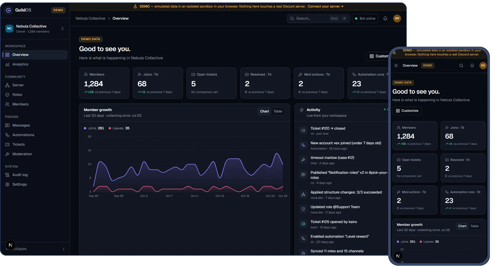
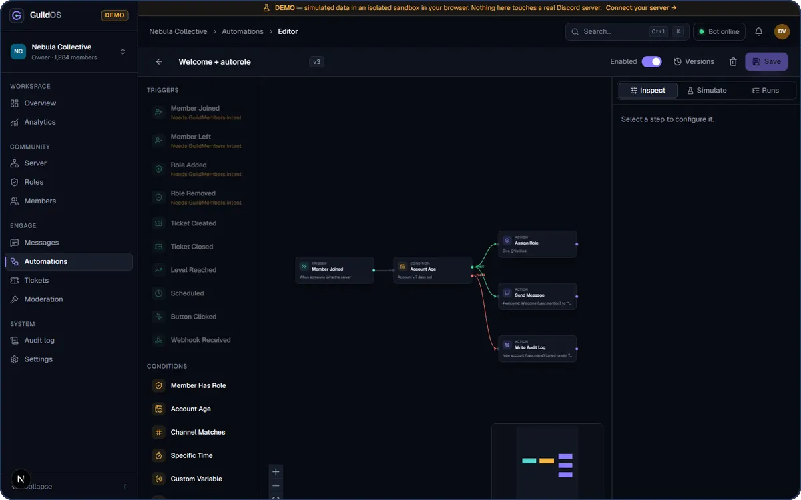
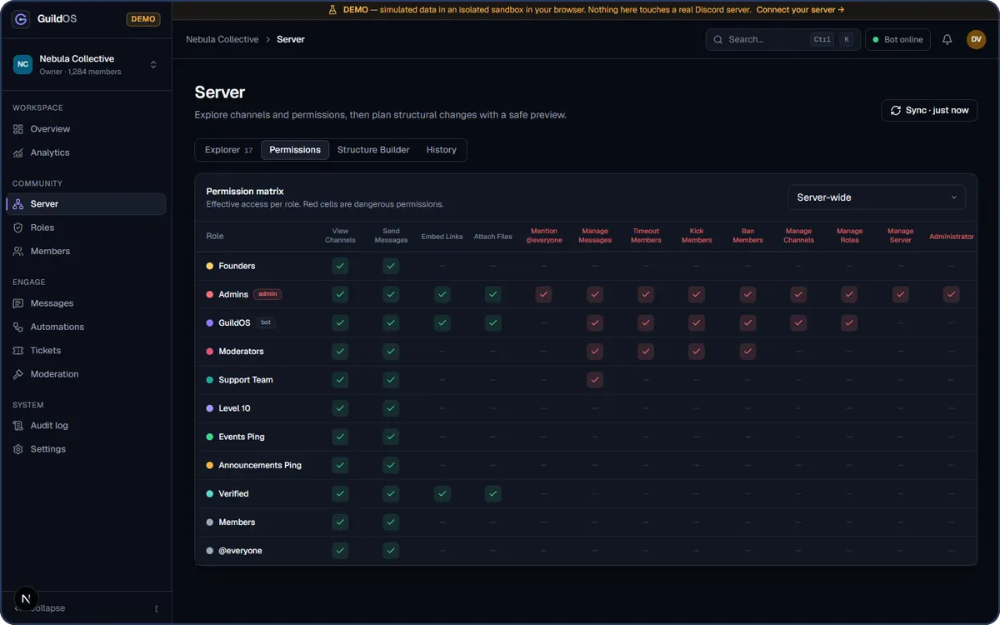

<picture>
  <source media="(prefers-color-scheme: dark)" srcset="assets/header-dark.svg">
  <source media="(prefers-color-scheme: light)" srcset="assets/header-light.svg">
  
</picture>

 

<a href="https://www.linkedin.com/in/gabriel-nunes-lopes-40621b3b5/"><picture><source media="(prefers-color-scheme: dark)" srcset="assets/links/linkedin-dark.svg"><source media="(prefers-color-scheme: light)" srcset="assets/links/linkedin-light.svg"></picture></a>&nbsp;
<a href="mailto:gabrielnuneslopes2022@gmail.com"><picture><source media="(prefers-color-scheme: dark)" srcset="assets/links/email-dark.svg"><source media="(prefers-color-scheme: light)" srcset="assets/links/email-light.svg"></picture></a>

 

### `01` Sobre mim

Sou estudante do curso **Técnico em Desenvolvimento de Sistemas no SENAI** e desenvolvo software com foco em **back-end**. Meus projetos vão além dos exercícios: bots que administram comunidades do Discord em produção, uma ponte de dados entre um jogo do Roblox e o Postgres, e o **GuildOS**, uma plataforma full-stack com API, worker, bot e painel web no mesmo monorepo.

Gosto da parte que não aparece no print: modelar dados, pensar em permissões, escrever migrations, cobrir o fluxo com testes e automatizar o deploy. Aprendo tecnologias novas quando o projeto pede — foi assim com Fastify, Drizzle, Supabase, os Components V2 do Discord e .NET.

 

### `02` Stack

<table>
  <tr>
    <td>
      <b>LINGUAGENS</b> 
      
      
      
      
      
       TypeScript · JavaScript · SQL · Luau · C# / .NET
    </td>
  </tr>
  <tr>
    <td>
      <b>BACK-END</b> 
      
      
      
      
      
       Node.js · Fastify · Express · Zod · discord.js · APIs REST · OAuth2
    </td>
  </tr>
  <tr>
    <td>
      <b>DADOS</b> 
      
      
      
      
      
       PostgreSQL · Supabase (RLS, Edge Functions) · Drizzle · Prisma · SQLite
    </td>
  </tr>
  <tr>
    <td>
      <b>FRONT-END</b> 
      
      
      
       Next.js · React · Tailwind CSS · TanStack Query · React Flow
    </td>
  </tr>
  <tr>
    <td>
      <b>QUALIDADE & DEPLOY</b> 
      
      
      
      
      
       Vitest · Playwright · node:test · GitHub Actions · Vercel · Render · Square Cloud
    </td>
  </tr>
</table>

 

### `03` Projetos em destaque

<picture>
  <source media="(prefers-color-scheme: dark)" srcset="assets/projects/guildos-dark.svg">
  <source media="(prefers-color-scheme: light)" srcset="assets/projects/guildos-light.svg">
  
</picture>

**O problema:** administrar uma comunidade grande no Discord exige vários bots, permissões editadas à mão e nenhum histórico de quem mudou o quê. O GuildOS reúne estrutura, permissões, mensagens, automações, tickets, moderação e métricas em um painel, com trilha de auditoria para tudo.

<b>Detalhes técnicos</b>

 

- **Monorepo pnpm** com `web` (Next.js 16 + React 19), `api` (Fastify 5 + Zod), `bot` (discord.js) e `worker`, todos compartilhando um pacote de domínio: o editor valida exatamente como o servidor.
- **Permissões efetivas** calculadas na ordem de resolução do próprio Discord, exibidas numa matriz por cargo e canal com permissões perigosas em destaque.
- **Alterações estruturais seguras:** prévia em forma de diff, aplicação idempotente e recusa automática se o servidor mudou desde a prévia.
- **Automation Studio** em React Flow com simulador, versões e prevenção de loops entre processos.
- **Fila de jobs no Postgres** (`FOR UPDATE SKIP LOCKED`), Drizzle com migrations versionadas e **RLS em todas as tabelas** no Supabase.
- **Segurança:** OAuth com tokens criptografados, proteção CSRF, isolamento entre workspaces e papéis de equipe verificados no servidor.
- **Qualidade:** TypeScript `strict`, testes de integração com PGlite e um fake da API do Discord, E2E com Playwright em desktop e mobile, CI no GitHub Actions e app Android (TWA) gerado por workflow.

 

Código privado. Screenshots reais do modo demo, que usa dados simulados.

 

<picture>
  <source media="(prefers-color-scheme: dark)" srcset="assets/projects/security-bot-dark.svg">
  <source media="(prefers-color-scheme: light)" srcset="assets/projects/security-bot-light.svg">
  
</picture>

**O problema:** um ataque de raid ou nuke apaga canais e cargos em segundos, e esperar a resposta de um banco remoto para reagir é tarde demais.

<b>Detalhes técnicos</b>

 

- **Caminho crítico local:** o ThreatEngine decide com SQLite (`node:sqlite`) e só depois persiste no Supabase, que é a fonte de verdade compartilhada entre reinícios e clientes.
- **Threat Score agregado** por servidor, executor e janela de 10 segundos, com expiração automática, para não gravar uma linha por evento num banco compartilhado.
- **Snapshots da estrutura** do servidor para rollback, e incidentes forenses com limite de eventos e política de retenção.
- Tabelas com prefixo próprio, **RLS habilitado** e acesso somente pela chave de serviço no back-end.

Código privado.

 

<picture>
  <source media="(prefers-color-scheme: dark)" srcset="assets/projects/keishodan-dark.svg">
  <source media="(prefers-color-scheme: light)" srcset="assets/projects/keishodan-light.svg">
  
</picture>

**O problema:** uma facção com regras próprias de progressão, desafios e partidas ranqueadas precisava que tudo isso acontecesse dentro do Discord, com registros confiáveis e sem depender de controle manual da staff.

<b>Detalhes técnicos</b>

 

- **Uma base de código, dois bots em produção:** a variável `BOT_MODE` define se a instância roda Progressão ou Atendimento.
- **Ranked 1v1 e 2v2** com filas, salas privadas e validação do resultado pelo adversário ou pela staff; ELO, vitórias, sequência e kills são confirmados numa **única transação Postgres**.
- **Leaderboard** com imagem do TOP 3 gerada dinamicamente (sharp) e cargos sincronizados automaticamente por faixa de ELO.
- Supabase/Postgres com RLS, migrations SQL versionadas e CI com formatação, typecheck, testes e build.

Código privado.

 

<picture>
  <source media="(prefers-color-scheme: dark)" srcset="assets/projects/summon-a-monster-dark.svg">
  <source media="(prefers-color-scheme: light)" srcset="assets/projects/summon-a-monster-light.svg">
  
</picture>

**O problema:** a comunidade de um jogo do Roblox precisava de canais organizados em dois idiomas e de uma forma segura de levar dados do jogo para o Discord, sem expor credenciais.

<b>Detalhes técnicos</b>

 

- **Adaptador Luau** no servidor do jogo envia eventos para uma **Supabase Edge Function** autenticada por token próprio, com validação estrita de tipo, tamanho e formato do payload.
- **Painéis em Components V2** em inglês e português, com preferência de idioma salva por membro e sem criar cargos de idioma.
- **Fluxo de aprovação:** rascunhos num servidor de teste e releases oficiais congeladas como snapshot, publicadas só com aprovação explícita.
- Prévia offline de todos os cards gerada a partir dos builders reais, e CI com typecheck, testes e build.

Código privado.

 

<a href="https://github.com/GabrielNunesLopes/livraria-api-grupo4">
<picture>
  <source media="(prefers-color-scheme: dark)" srcset="assets/projects/livraria-api-dark.svg">
  <source media="(prefers-color-scheme: light)" srcset="assets/projects/livraria-api-light.svg">
  
</picture>
</a>

**O problema:** projeto da disciplina de Programação Back-End, feito em equipe de quatro pessoas: modelar o domínio de uma livraria e expor uma API organizada em camadas.

<b>Detalhes técnicos</b>

 

- Camadas **routes → controllers → services → models**, partindo de um diagrama de classes UML.
- Middlewares de log, rota não encontrada, validação de ID e tratamento centralizado de erros.
- CRUD REST de livros e categorias com **coleção Postman versionada** no repositório e análise de riscos do projeto.

**[Ver repositório →](https://github.com/GabrielNunesLopes/livraria-api-grupo4)**

 

**Também construí:** **Casa Westerling**, bot de RP com fichas, avaliação de ingresso, missões e treinos (discord.js + Postgres), e **Gakuran BR Hub**, núcleo de identidade de uma comunidade com moderação automática e uma API interna autenticada para outros bots (TypeScript + Prisma).

 

### `04` Atividade

<picture>
  <source media="(prefers-color-scheme: dark)" srcset="assets/activity-dark.svg">
  <source media="(prefers-color-scheme: light)" srcset="assets/activity-light.svg">
  
</picture>

 

### `05` Em foco agora

- **Tempo real entre processos:** filas no Postgres, workers e `LISTEN/NOTIFY` para levar eventos de um processo a outro.
- **Segurança por padrão:** RLS, menor privilégio, OAuth e proteção contra SSRF desde o desenho do sistema.
- **Testes dentro do fluxo:** integração com fakes de APIs externas e E2E em desktop e mobile.
- **Base no curso técnico:** POO, MVC, UML e Clean Code, com os exercícios em [`programacao-backend`](https://github.com/GabrielNunesLopes/programacao-backend).

 

<picture>
  <source media="(prefers-color-scheme: dark)" srcset="assets/footer-dark.svg">
  <source media="(prefers-color-scheme: light)" srcset="assets/footer-light.svg">
  
</picture>
